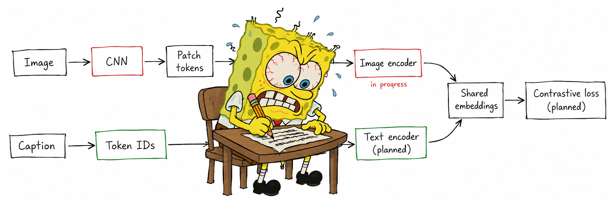
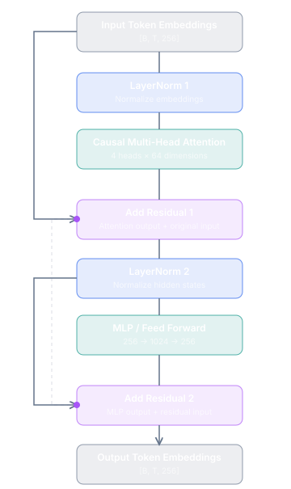

<p align="center">
  
</p>

<h1 align="center">Building a Vision–Language Model in PyTorch</h1>
<p align="center">Learning how pixels and words connect, one layer at a time.</p>
<p align="center">
  
  
  
</p>

## About

A learning project for implementing the pieces of a vision–language model in PyTorch. The current work includes a convolutional vision transformer with a class token, learned positional embeddings, and an image projection, and a causal text transformer with token embeddings, learned positional embeddings, end-of-text pooling, and a text projection. A notebook explores these components alongside a synthetic dataset of colored shapes paired with captions.

The intended direction is a CLIP-style model that maps images and text into a shared embedding space. **The full model and training pipeline are not implemented yet.**

## What's in the repo

| File | Current content |
| --- | --- |
| [`src/model_arch.py`](src/model_arch.py) | Image feature extraction, patch embedding, attention, `VisionTransformerCLIP`, `TextTransformerEncoder`, and `TextEncoder`. |
| [`src/model.py`](src/model.py) | Empty placeholder for assembling the paired model. |
| [`src/tokenization.py`](src/tokenization.py) | Initial `tiktoken` import; tokenizer implementation pending. |
| [`experimentation/vlm.ipynb`](experimentation/vlm.ipynb) | Synthetic dataset, vocabulary and tokenization, train/validation loaders, a CNN image encoder prototype, a text encoder scaffold, and an image features → patches → attention experiment. |
| [`src/dataloader.py`](src/dataloader.py) | Initial PyTorch data-loading imports. |
| [`src/clip_loss.py`](src/clip_loss.py) | Empty placeholder for contrastive loss. |
| [`src/train.py`](src/train.py) | Empty placeholder for training. |
| [`src/eval.py`](src/eval.py) | Empty placeholder for evaluation. |
| [`main.py`](main.py) | Empty entry-point placeholder. |

## The model idea

```text
Image → Convolutional features → Patch tokens → Image encoder ─┐
                                                             ├→ Shared embeddings → Contrastive loss
Caption → Token IDs → Text encoder ───────────────────────────┘
```

This describes the intended pipeline. `VisionTransformerCLIP` assembles the image branch and returns a projected image embedding. `TextEncoder` assembles the text branch and also returns a 256-dimensional embedding. Pairing the encoders, normalizing embeddings for similarity scoring, implementing compatible tokenization, contrastive loss, and training remain unfinished.

### Image encoder work

`ImageFeatureMap` starts with a 3 → 32 channel convolution, then uses depthwise and pointwise convolutions to reach 256 channels. Its forward pass returns the feature map. `PatchEmbedding` applies a 4 × 4 convolution with stride 4 and converts the result into `[batch, tokens, 256]` sequences.

`MultiHeadAttention` implements Q/K/V projections, scaled dot-product attention, attention dropout, head concatenation, and an output projection with dropout. The defaults are **256 embedding dimensions and 4 heads**.

`MLP` expands the embedding dimension by a factor of 4, applies GELU, and projects back to 256 dimensions. `TransformerEncoder` combines pre-attention and pre-MLP layer normalization with residual connections around both sublayers.

For a **224 × 224** input, the default components have these tensor shapes:

```text
[B, 3, 224, 224]
  → ImageFeatureMap    → [B, 256, 28, 28]
  → PatchEmbedding     → [B, 49, 256]
  → Add class token    → [B, 50, 256]
  → Add positions      → [B, 50, 256]
  → 12 encoder blocks  → [B, 50, 256]
  → LayerNorm + CLS    → [B, 256]
  → Image projection   → [B, 256]
```

`VisionTransformerCLIP` defaults to 12 encoder blocks. It uses a learned class token and a fixed table of 50 positional embeddings, then projects the normalized class-token features to 256 dimensions. The returned embeddings are not L2-normalized. Use the default embedding dimension of 256: the patch embedding and transformer blocks currently hard-code that width. Inputs must produce 49 patch tokens; the documented input size is 224 × 224. The 64 × 64 synthetic images therefore need resizing before use with this encoder.

### Text encoder work

<p align="center">
  
</p>

`CausalMultiHeadAttention` defaults to **4 heads**, **77 context tokens**, and **256 embedding dimensions**. It masks future tokens before softmax, applies attention dropout, concatenates heads, and applies an output projection and projection dropout. Its output has shape `[batch, tokens, 256]`.

`TextTransformerEncoder` adds pre-norm attention and MLP sublayers with residual connections. `TextEncoder` stacks **6 blocks** by default, using a **49,408-token vocabulary**, learned positional embeddings, final layer normalization, end-of-text pooling, and a projection to 256 dimensions.

```text
Token IDs             → [B, T]
  → Token + positions → [B, T, 256]
  → 6 causal blocks   → [B, T, 256]
  → LayerNorm         → [B, T, 256]
  → End-of-text pool  → [B, 256]
  → Text projection   → [B, 256]
```

Use the default width of 256 and sequences of at most 77 tokens: the internal blocks currently use fixed defaults, and the `num_heads` argument on `TextEncoder` is not passed through. Each sequence must contain end-of-text token **49407**; pooling selects its first occurrence and falls back to position zero if it is absent. Returned embeddings are not L2-normalized.

Compatible tokenization is still pending. The notebook's small word-level vocabulary and `[CLS]` token do not provide the end-of-text convention expected by this encoder. `src/tokenization.py` currently only imports `tiktoken`; that import alone does not configure a compatible tokenizer.

The notebook also contains an earlier CNN image encoder prototype that produces normalized 64-dimensional embeddings. Its `TextEncoder` currently declares layers but leaves `forward` unimplemented.

### Synthetic image–caption data

The notebook generates **243 pairs** from every combination of:

- **9 colors:** red, green, blue, yellow, purple, orange, pink, brown, gray.
- **3 shapes:** square, circle, triangle.
- **9 positions:** left, center, right, top, bottom, and the four corners.

Images are drawn at **64 × 64** pixels using Pillow and converted to channel-first float tensors scaled to `[0, 1]`. Captions such as `red circle top-left` are split into words and prepended with a `[CLS]` token. No external dataset download is needed for this experiment.

The notebook splits the dataset into **194 training pairs and 49 validation pairs**, with a batch size of 12. Its separate attention experiment uses random 224 × 224 inputs.

## Explore locally

Use a Python environment compatible with PyTorch. There is no pinned dependency file yet.

```bash
git clone https://github.com/Sujalkr451/Coding-Vision-Language-Model-in-Pytorch-.git
cd Coding-Vision-Language-Model-in-Pytorch-
python -m venv .venv
source .venv/bin/activate
python -m pip install torch numpy pillow matplotlib jupyter
jupyter notebook experimentation/vlm.ipynb
```

On Windows, activate the environment with `.venv\Scripts\activate` instead. Run the notebook cells in order to generate the dataset and inspect the image tensors, captions, and vocabulary. The notebook selects Apple MPS when available and otherwise uses the CPU.

There is no training command, trained checkpoint, or evaluation result yet; running `main.py` currently does nothing.

## Next steps

- [x] Generate synthetic shapes with matching captions.
- [x] Build a vocabulary and encode captions.
- [x] Create train/validation splits and data loaders in the notebook.
- [x] Implement the convolutional feature map and its forward pass.
- [x] Implement patch tokenization and custom multi-head self-attention.
- [x] Add a GELU MLP and a pre-norm transformer encoder block with residual connections.
- [x] Add a class token, positional embeddings, and assemble the image encoder.
- [x] Implement causal multi-head attention for the text branch.
- [x] Implement a causal text encoder with end-of-text pooling and a 256-dimensional projection.
- [ ] Implement compatible tokenization and connect both encoders for image–text similarity.
- [ ] Add contrastive loss and a training loop.
- [ ] Evaluate image–text matching and retrieval.

## Contributing

This is an evolving learning project. Issues explaining bugs, tensor shapes, or implementation ideas are welcome. For code changes, describe what changed and how you checked it.
